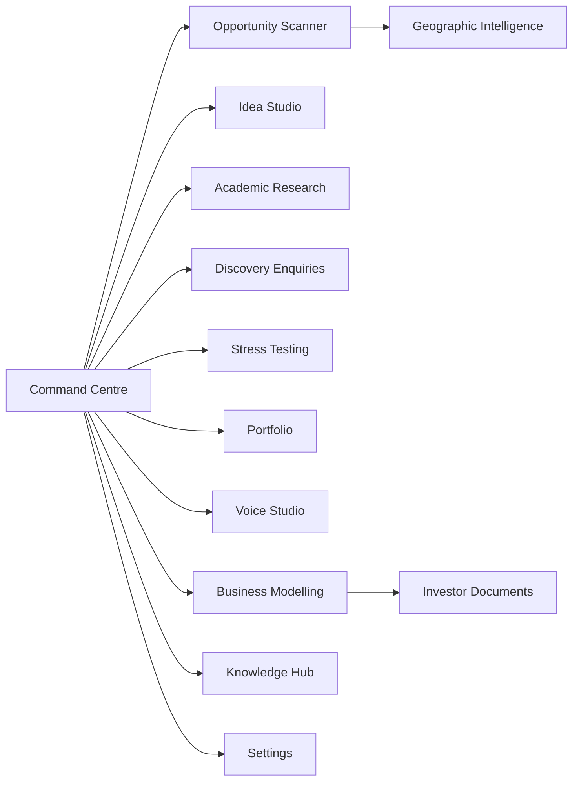
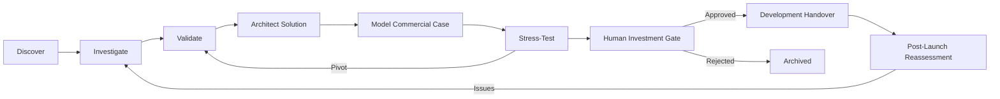
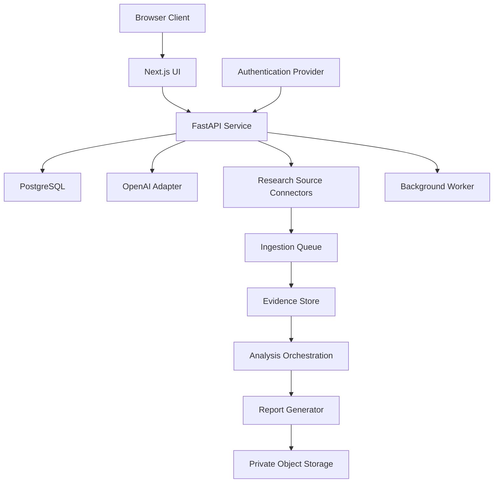
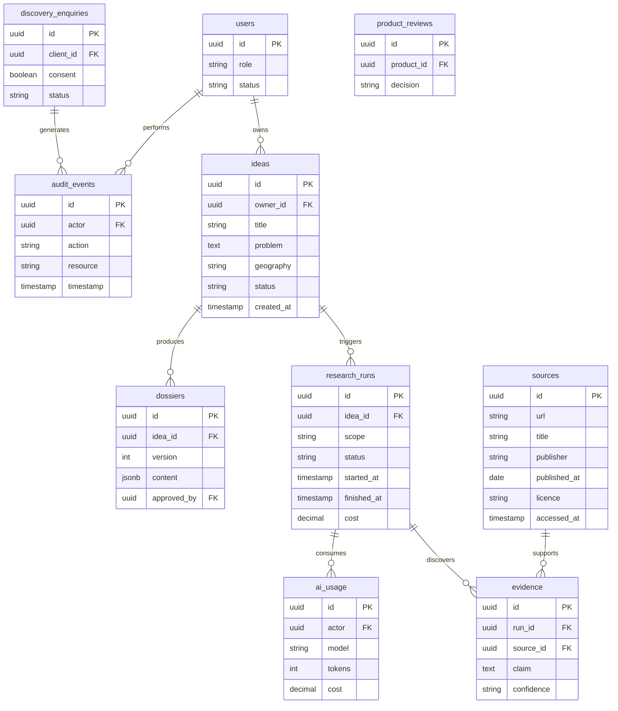
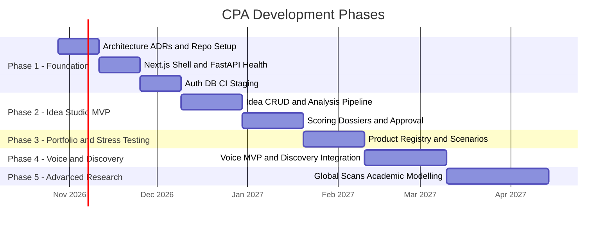
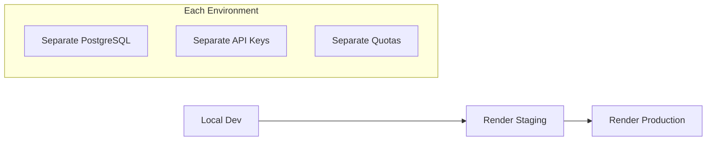

# CPA — Project Blueprint

**Dwen Tech Ltd | Chief Product Architect — AI Research & Product Innovation Laboratory**
**Version:** 1.2 draft · **Date:** 20 October 2026 · **Classification:** Confidential — Internal
**Status:** Proposed baseline — CEO product approval and Justice technical review pending

---

**Current local working instruction:** Use this existing `002 CPA` folder and `progress.md`. All GitHub activity is deferred: no remote access, clone, pull, merge or modification. References to GitHub issues, branches, PRs and remote checks below describe the deferred delivery workflow, not a prerequisite for the currently selected local documentation task. B001 was accepted by the user; later tasks and gates need their own evidence.

## Table of Contents

1. [Executive Summary](#1-executive-summary)
2. [Vision & Objectives](#2-vision--objectives)
3. [Operating Principles](#3-operating-principles)
4. [Target Users & Personas](#4-target-users--personas)
5. [Product Domains](#5-product-domains)
6. [End-to-End Opportunity Lifecycle](#6-end-to-end-opportunity-lifecycle)
7. [Feature Requirements](#7-feature-requirements)
8. [Opportunity Scoring Model](#8-opportunity-scoring-model)
9. [System Architecture](#9-system-architecture)
10. [Data Model](#10-data-model)
11. [API Surface](#11-api-surface)
12. [AI Intelligence Framework](#12-ai-intelligence-framework)
13. [UI/UX Design](#13-uiux-design)
14. [Development Roadmap](#14-development-roadmap)
15. [Security, Data & AI Governance](#15-security-data--ai-governance)
16. [Testing & Acceptance](#16-testing--acceptance)
17. [Deployment & Operations](#17-deployment--operations)
18. [Team Structure & Working Agreement](#18-team-structure--working-agreement)
19. [Non-Goals & Boundaries](#19-non-goals--boundaries)
20. [Open Decisions & Next Actions](#20-open-decisions--next-actions)

---

## 1. Executive Summary

CPA (Chief Product Architect) is Dwen Tech Ltd's internal **AI Research & Product Innovation Laboratory**. It discovers significant societal and organisational problems, validates whether solving them creates value, designs potential software solutions, and prepares investment recommendations backed by evidence.

CPA is **not** merely an idea generator. It is a full lifecycle system spanning discovery → investigation → validation → architecture → commercial modelling → stress-testing → human investment gate → development handover → post-launch reassessment.

> **Important:** This blueprint consolidates Documents 001–010 of the Development Handover Pack v1.0 into a single actionable reference. It does **not** replace those documents — it unifies them. All implementation must still trace back to approved issues and ADRs.

---

## 2. Vision & Objectives

Build an **evidence-led, internationally aware** research and innovation system. Core outcomes:

| Objective | Description |
|---|---|
| **Discover problems** | Surface real societal/organisational pain points across geographies |
| **Validate demand** | Confirm users exist and willingness to pay |
| **Challenge assumptions** | Sceptically test founder hypotheses with counter-evidence |
| **Develop product concepts** | Design feasible software solutions |
| **Model viable businesses** | Build commercial cases with labelled assumptions |
| **Investor readiness** | Generate business plans, investment memos, pitch outlines |
| **Preserve knowledge** | Maintain versioned research dossiers, citations and decision history |
| **Support portfolio** | Serve OnCallX, Krommu, Meznja and new product ideas |

### MVP Success Definition

An authorised user can submit an idea, obtain an OpenAI-assisted evidence-labelled assessment, challenge it, save and retrieve the dossier, and submit it for human review. Success is measured by **evidence quality, decisions improved, opportunities validated, and time saved** — not volume of ideas.

---

## 3. Operating Principles

- **Problem-first** — Start with real problems, not solutions
- **Evidence & provenance** — Every claim has a cited source or is labelled as hypothesis
- **Explicit confidence** — State uncertainty levels and assumptions openly
- **Sceptical product challenge** — Actively seek disconfirming evidence
- **Human approval gates** — No autonomous investment, publishing or deployment
- **Least-privilege access** — Minimum permissions at every layer
- **Responsible AI** — Labelled outputs, licensed research, no fabrication
- **Measured costs** — Per-run budgets, spending caps, cost telemetry
- **Phased delivery** — Maintainable increments, not big-bang releases

---

## 4. Target Users & Personas

| Persona | Role | Access Scope |
|---|---|---|
| **Founder/CEO** | Investment approval, product & commercial sign-off | All strategic reports, approval, portfolio overview |
| **Human CPA / Product Innovation Lead** | Research, evaluation, dossier preparation | Submit/review ideas, initiate scans, prepare dossiers |
| **Justice / Technical Lead** | Architecture, code review, technical oversight | Technical settings, deployments, audit, full authorised access |
| **Assistant Developer** | Implementation of assigned tasks | Development/staging access; no production secrets by default |
| **Future Analysts** | Expanded research team | Role-appropriate scoped access |
| **External Discovery Client** | Bespoke problem submission | Own enquiry and approved responses only (separate channel) |

> **Warning:** Enforce tenant/record-level access checks on the **server**. Never rely solely on hidden UI elements for security.

---

## 5. Product Domains



| Domain | Purpose |
|---|---|
| **Command Centre** | Central dashboard — KPIs, pipeline, alerts, approvals |
| **Opportunity Scanner** | Country/region/global problem discovery from permitted sources |
| **Idea Studio** | Idea creation → AI analysis → scoring → dossier → review |
| **Academic Research** | Open-access and licensed research discovery with licence tracking |
| **Client Discovery** | Secure external enquiry intake → internal triage → approved response |
| **Stress Testing** | Multi-scenario product viability assessment with counter-evidence |
| **Product Portfolio** | Product lifecycle, stages, owners, decisions, dependencies |
| **Voice Studio** | Push-to-talk AI research conversations with transcription |
| **Business Modelling** | Financial models, business plans, investment memos, pitch outlines |
| **Knowledge Hub** | Indexed dossiers, evidence, citations, provenance, retrieval |
| **Settings** | User management, AI configuration, notifications, system controls |

---

## 6. End-to-End Opportunity Lifecycle



An opportunity may return to an earlier stage or be rejected at any gate. The lifecycle is iterative, not linear.

---

## 7. Feature Requirements

### 7.1 OpenAI Intelligence Integration (CPA-AI-001)

- **Server-side only** — No browser-exposed API keys
- Every AI request records: actor, purpose, model, token/cost telemetry, request ID, error state, retained output
- Not every operation needs a model call — scheduling, retrieval, filtering, calculations use deterministic services
- OpenAI handles: interpretation, comparison, reasoning, drafting
- Required: timeouts, retries, rate limits, spending caps, graceful failure
- ChatGPT subscriptions are **separate** from API billing

### 7.2 Command Centre (CPA-CORE-001)

- Dashboard cards: active research runs, ideas awaiting review, new Discovery enquiries, portfolio risk alerts, AI usage spend, approvals due
- Lists reflect **real stored records** — sample data clearly labelled
- Filters: date, region, status, owner
- Role-sensitive actions

### 7.3 Geography Selector (CPA-GEO-001)

- Select: one/multiple countries, region(s), or Global
- Location taxonomy with ISO country codes; Wales as subnational UK selection
- Source availability indicators, language/currency context
- Scan time window and sector selection
- "Global" = multi-region coverage with **limitations clearly displayed** — never implies exhaustive surveillance

### 7.4 Opportunity Scanner (CPA-MI-001)

- Scope → sector → date range → scan objective
- Creates research run; collects permitted sources; deduplicates; extracts evidence
- OpenAI identifies problems and solution hypotheses
- Scores with source quality; stores citations and timestamps
- Routes candidates to human review; scheduled runs in later phases

### 7.5 Idea Studio (CPA-ID-001)

- CRUD operations on ideas (problem, affected group, geography, evidence, hypotheses)
- Structured AI assessment: assumptions, competitors, alternatives, risks, pricing hypotheses, opportunity score, missing evidence, citations, validation experiments
- Idea statuses listed by D002: Draft, Researching, Review, Validate, Approved, Rejected and On Hold. These are an unordered vocabulary, not an automatic transition sequence. Dossier versions are separate records; permitted transitions and approval meanings remain open under O-09.

### 7.6 Stress Testing (CPA-ST-001)

- Select portfolio product or idea
- Assess: severity, willingness to pay, competitors, technical, regulatory, growth, business model, strategic fit
- Produce optimistic / base / pessimistic scenarios
- Recommendations: Continue / Improve / Pivot / Pause / Stop, each with evidence, counterarguments and a human decision log. The user confirmed all five during B002 on 20 October 2026. Definitions, scenario rules and any status effects remain open under O-10; a recommendation never authorises investment.

### 7.7 Academic Research (CPA-RI-001)

- Search approved open-access repositories and licensed sources
- Store: metadata, licence, DOI/URL
- Extract findings with uncertainty levels
- Map findings to real-world problems and potential software applications
- Restricted articles require explicit rights — no automatic copying or commercialisation

### 7.8 Client Discovery (CPA-CD-001)

- Receive enquiries via authenticated integration / webhook / secured API
- Validate: input, anti-spam, consent, reference number, notifications
- Separate client confidentiality; follow-up questions supported
- Internal proposal → human approve before any outbound communication
- Track bespoke vs. reusable product path (contractual/IP review required)

### 7.9 Voice Studio (CPA-VOICE-001)

- Push-to-talk or realtime voice with streaming transcript
- Interruption support, project linkage, consent/retention controls
- Session summary and action items
- Same permissioned knowledge and AI workflows as text
- Deliver **incrementally after text workflows** are stable

### 7.10 Business Modelling (CPA-BM-001)

- From validated opportunity: customer segments, value proposition, business model canvas, competitor positioning, pricing assumptions
- TAM/SAM/SOM with methodology, revenue drivers, unit economics, costs, funding need, sensitivity/scenarios, risks, milestones
- Generate: editable business plan, investment memo, pitch deck outline, financial-model assumptions
- **No unsupported numbers** — all inputs and calculations labelled

### 7.11 Portfolio & Knowledge Hub (CPA-PM-001, CPA-KH-001)

- **Portfolio:** Product stages, owners, assessments, decision history, milestones, dependencies
- **Knowledge Hub:** Indexed authorised sources, dossier versions, research logs, evidence citations, access control, provenance, retention, retrieval

### 7.12 Cross-Cutting Requirements

Search · filters · accessible responsive UI · audit log · role-based access · versioning · export · background task status · cancel/retry · provenance · UTC timestamps with timezone display · privacy controls · notification preferences · usage analytics · API and UI error states

---

## 8. Opportunity Scoring Model

| Factor | Weight |
|---|---|
| Problem Severity | 20% |
| Willingness to Pay | 20% |
| Market Size | 15% |
| AI Differentiation | 15% |
| Commercial Accessibility | 10% |
| Feasibility | 10% |
| Strategic Fit | 10% |

- Rate each factor **0–5** with rationale and evidence strength
- Weighted total = `Σ (weight × rating / 5)`
- Display as **heuristic** — never as "probability of success"
- Red-flag risks may override the numeric score

---

## 9. System Architecture

The stack, diagrams, schema, API examples and provider candidates are proposed design material. They do not constitute approved ADRs or deployed services. O-03–O-08 and the relevant later decisions gate dependent implementation.

### 9.1 Technology Stack

| Layer | Technology |
|---|---|
| **Frontend** | Next.js / TypeScript |
| **Backend API** | FastAPI / Python |
| **Database** | PostgreSQL with migrations |
| **AI Provider** | OpenAI API (server-side only) |
| **Background Jobs** | Worker process (queue TBD) |
| **Object Storage** | For generated reports / documents |
| **Hosting** | Render (web services + worker) |
| **CI/CD** | GitHub Actions |
| **Repository** | `dwentech-ltd/dwentech-cpa` (private) |

### 9.2 Logical Architecture



### 9.3 Repository Layout

The tree below is a proposed future layout. In this local folder, the original documents are at `CPA_Development_Handover_Pack_v1/docs/001-*` through `010-*`; repository working rules are at `CPA_Development_Handover_Pack_v1/AGENTS.md`. Resolve those actual paths when reading sources. Do not move or rewrite the original handover pack to make its historical `docs/handover-pack-v1/` instruction match the proposed tree. Any future import belongs to B009.

```
frontend/                          # Next.js application
backend/
  app/
    api/                           # FastAPI route handlers
    models/                        # SQLAlchemy / Pydantic models
    services/
      ai/                          # OpenAI adapter & prompt templates
      research/                    # Source connectors & evidence extraction
    workers/                       # Background job processors
  tests/                           # Backend test suite
database/
  migrations/                      # Alembic migrations
docs/
  handover-pack-v1/                # Documents 001–010
  adr/                             # Architecture Decision Records
.github/
  workflows/                       # CI/CD pipelines
  PULL_REQUEST_TEMPLATE.md
.env.example                       # Config template (no live values)
AGENTS.md                          # Repository working rules
```

### 9.4 AI Adapter Design

- Single server-side abstraction with model selection config
- Prompt templates under version control
- JSON schema output validation
- Refusal/error handling
- Logging with sensitive-field redaction
- Token/cost metering
- Test doubles for development/CI
- **Security:** Tool responses are untrusted inputs — guard against prompt injection and citation laundering

---

## 10. Data Model



> **Note:** Add row-level isolation for client data. Discovery enquiry data must never leak across clients.

---

## 11. API Surface

Illustrative contracts — full OpenAPI schemas, validation, pagination, idempotency for job creation, structured errors and authentication required.

| Method | Endpoint | Purpose | Response |
|---|---|---|---|
| `POST` | `/api/v1/ideas` | Create new idea | `201 Created` |
| `GET` | `/api/v1/ideas/{id}` | Retrieve idea | `200 OK` |
| `POST` | `/api/v1/ideas/{id}/analyse` | Queue analysis run | `202 Accepted` + `run_id` |
| `GET` | `/api/v1/research-runs/{id}` | Check run status/results | `200 OK` |
| `GET` | `/api/v1/dossiers/{id}` | Retrieve dossier | `200 OK` |
| `POST` | `/api/v1/opportunity-scans` | Start opportunity scan | `202 Accepted` |
| `GET` | `/api/v1/geographies` | List available geographies | `200 OK` |
| `POST` | `/api/v1/discovery-enquiries` | Submit client enquiry | `201 Created` |
| `GET` | `/api/v1/usage` | AI usage statistics | `200 OK` |

---

## 12. AI Intelligence Framework

### 12.1 Design Stance

Begin with a **single orchestrated workflow** using specialised prompts/services. Do **not** create independently autonomous agents merely to mimic a research lab. Add agent separation only when measurable quality, security or maintenance benefits justify it.

### 12.2 Agent / Function Catalogue

| Agent/Function | Responsibility |
|---|---|
| **Discovery Researcher** | Source-based problem discovery |
| **Market Analyst** | Demand, market scope, pricing evidence |
| **Competitor Analyst** | Alternatives and differentiation |
| **Academic Analyst** | Research findings and licence compliance |
| **Solution Architect** | Workflows and feasible feature design |
| **Feasibility Reviewer** | Technical constraints assessment |
| **Commercial Modeller** | Financial assumptions and scenarios |
| **Risk Reviewer** | Privacy, regulatory and operational risks |
| **Critical Challenger** | Adversarial critique and disconfirming evidence |
| **Evidence Auditor** | Citation verification and uncertainty labelling |
| **Report Composer** | Coherent dossiers and investor outputs |

### 12.3 Execution Contract

Every run records: requestor, jurisdiction, objective, authorised tools, input source list, budget, timeout, outputs, human-review status.

**Sequence:** Define question → collect sources → validate provenance → extract claims → compare/counter-check → score → draft report → audit citations → save version → human review.

### 12.4 Research Evidence Policy

Every externally derived material claim requires:
- URL/DOI, title, publisher
- Publication/access date
- Source type and licence (if applicable)
- Quotation/summary boundaries

Missing evidence is labelled as **hypothesis**. Source collection must obey robots.txt, terms of service, rate limits, copyright and permissions.

### 12.5 Structured Opportunity Output Schema

```json
{
  "problem_statement": "",
  "geography": "",
  "impacted_users": "",
  "severity_score": 0,
  "demand_evidence": [],
  "competitors": [],
  "proposed_solution": "",
  "ai_advantage": "",
  "pricing_hypotheses": "",
  "market_estimate_assumptions": "",
  "feasibility": "",
  "risks": [],
  "source_refs": [],
  "evidence_grade": "",
  "scoring_breakdown": {},
  "recommendation": "",
  "validation_experiments": [],
  "human_decision": ""
}
```

### 12.6 Global Scan Semantics

A "Global" scan is a **multi-region research plan**, not omniscience. Record which countries, languages, sectors, feeds and time windows were actually covered. Show gaps, source bias and coverage limitations.

### 12.7 Cost Controls

- Per-run budget and per-user quotas
- Monthly spending alerts
- Max source count and retry ceiling
- Cancellation support
- Log: model, latency, input/output tokens, cost estimate, quality checks, exceptions
- **Never leak sensitive prompts** in logs

---

## 13. UI/UX Design

### 13.1 Design Direction

Professional research laboratory dashboard — light neutral content surfaces, restrained navy navigation and blue accents, legible tables/charts, accessible contrast and keyboard navigation. **Data-dense but uncluttered.** Desktop-first responsive.

> **Important:** No fictional metrics presented as live data. Sample data must be clearly labelled.

### 13.2 Navigation Map

```
Dashboard (Command Centre)
├── Global Research Lab
├── Geographic Intelligence
├── Market & Society Scanner
├── Discovery Enquiries
├── University Research
├── Human Idea Studio
├── CPA Voice Studio
├── Product Opportunity Analysis
├── Product Stress Testing
├── Business Modelling Studio
├── Product Portfolio
├── Investor Readiness
├── Research Library
├── Reports & Analytics
└── Settings
```

### 13.3 Key Screen Layouts

**Command Centre:**
- Header: organisation, user, notifications, global search, geography selector
- KPI cards: research runs, pending reviews, new enquiries, portfolio alerts, AI spend
- Main area: opportunity pipeline, recent research, stress-test summaries, approvals, activity feed
- Quick-action cards: Idea Studio, Stress Testing, Business Modelling, Portfolio

**Idea Studio:**
- Left panel: idea details and research inputs
- Centre: research run progress and evidence-linked analysis tabs
- Right panel: scoring, missing evidence, decision actions
- Actions: Save draft, Analyse, Challenge assumptions, Export dossier, Submit for review

**Scanner:**
- Scope picker (country/region/global), sector, timeframe, source filters, scan budget
- Results table: problem, location, score, evidence strength, source count, date, review status
- Drill-down: evidence, assumptions, citations

### 13.4 User Journeys

| ID | Journey |
|---|---|
| **UJ-01** | CEO reviews pending dossier → opens sources → approve / return / reject |
| **UJ-02** | Human CPA creates idea → analyses → challenges → revises → submits |
| **UJ-03** | Human CPA selects Ghana → runs limited scan → reviews evidence → promotes opportunity |
| **UJ-04** | Client submits Discovery enquiry → authorised staff triages → human approves response |

### 13.5 States & Accessibility

Design for: loading, empty, partial, error, access denied, stale-source states. Target **WCAG 2.2 AA**: semantic forms, focus states, labelled charts, keyboard access, text alternatives, screen-reader announcements. Every destructive action requires confirmation.

---

## 14. Development Roadmap

### Governance

- Justice = technical owner; assistant developer implements assigned issues; CEO accepts product scope
- Weekly planning/demo; short written progress update; code review per PR; phase-end acceptance
- Estimate story points and dates **only after architecture review**

### Phase Overview

**Illustration only — not an approved schedule.** The following chart retains the earlier draft's 28 October 2026 start and durations for traceability. It does not establish deadlines or estimates. D006 requires estimates/dates after architecture review; O-18 remains open. Use the undated dependency order in `build-order.md` for current planning.



### Phase 1 — Foundation

| ID | Task | Exit Criteria |
|---|---|---|
| P1-01 | Architecture ADRs | Documented decisions with options, trade-offs, owner, date |
| P1-02 | Repository structure & local dev setup | Working local environment |
| P1-03 | Next.js shell with navigation | Navigable UI shell |
| P1-04 | FastAPI health endpoint & OpenAPI | `/health` returns OK; OpenAPI spec generated |
| P1-05 | PostgreSQL migrations | Schema applied; rollback tested |
| P1-06 | Authentication & RBAC | Signed-in user with role enforcement |
| P1-07 | OpenAI adapter with mocked tests | Adapter passes unit tests with test doubles |
| P1-08 | CI: lint & test pipeline | PR checks block on failure |
| P1-09 | Render staging deployment | App running on staging URL |
| P1-10 | Dashboard with real DB records | KPI cards from actual data |

**Exit:** Signed-in staging app, API, database, tests, logs and secrets secure.

### Phase 2 — Idea Studio MVP

P2-01 Idea CRUD · P2-02 Analysis request/job · P2-03 Source ingestion & provenance · P2-04 Structured OpenAI analysis · P2-05 Weighted scoring & risk flags · P2-06 Dossier versioning · P2-07 Human approval & audit · P2-08 Report export · P2-09 End-to-end tests.

**Exit:** Complete idea-to-saved-dossier journey.

### Phase 3 — Portfolio & Stress Testing

P3-01 Product registry · P3-02 Review workflow · P3-03 Optimistic/base/pessimistic scenarios · P3-04 Critical challenge · P3-05 Recommendation approval history · P3-06 Product-specific tests.

### Phase 4 — Voice & Discovery

P4-01 Consent & transcript storage · P4-02 Voice MVP · P4-03 Knowledge-linked conversations · P4-04 Discovery website integration · P4-05 Secure enquiry queue · P4-06 Proposal draft & approval · P4-07 Security & privacy tests.

### Phase 5 — Advanced Research & Modelling

P5-01 Geography catalogue · P5-02 Country/global scans with coverage logs · P5-03 Scheduler/alerts · P5-04 Licensed academic connectors · P5-05 Commercial model editor · P5-06 Business plan & pitch exports · P5-07 Advanced evaluation & cost controls.

### Definition of Ready

Issue has: user value, scope, non-goals, acceptance criteria, dependencies, test plan, security implications, owner, design reference. Unclear issues return to backlog for clarification.

### Definition of Done

PR linked to issue · reviewed by eligible independent reviewer · tests and lint pass · migrations and docs updated · secrets scan passes · staging demonstration · acceptance criteria checked · CEO accepts product functionality for phase milestone.

---

## 15. Security, Data & AI Governance

### 15.1 Threat Model

| Asset | Threats |
|---|---|
| Company IP & research dossiers | Unauthorised access, data leakage |
| Client Discovery submissions | Cross-client data leakage, confidentiality breach |
| User accounts | Credential compromise |
| API keys & model budget | Secret exposure, abusive API costs |
| Research integrity | Prompt injection, poisoned sources, citation laundering |
| Deployment | Insecure configuration, accidental deletion |

### 15.2 Identity & Access

- MFA for GitHub and privileged accounts
- Least-privilege GitHub teams; protected `main` / `develop`
- Feature branches; independent PR review (non-author)
- Production deploy rights: Justice and CEO-authorised administrators only
- App RBAC with server-side object-level authorisation
- No shared developer logins

### 15.3 Data Protection

- Data inventory: purposes, lawful basis, retention schedules, access controls
- UK GDPR review and DPIA triggers before handling personal/sensitive client data
- Minimise stored prompts; anonymise analytics
- Encrypt transit and at rest
- Documented deletion and DSAR process

### 15.4 AI Safety

- Model outputs are **drafts** — label uncertainty and unverifiable claims
- External pages/files are untrusted — never execute embedded instructions
- Avoid passing sensitive client data to third-party models without contractual/legal review
- Guard against prompt injection and citation laundering

### 15.5 Academic & Client IP

- Respect publisher licences, university permissions, research copyright
- Never repurpose confidential client enquiries as product IP without review and rights

### 15.6 Operational Controls

- Secrets in Render/GitHub secrets managers — **never in repository**
- Dependency scanning and secret scanning
- Pinned dependencies
- Audit events logged
- Backup/restore drills
- Incident escalation procedures
- Per-run AI spending limits

### 15.7 Human Approval Gates

| Approver | Scope |
|---|---|
| **CEO** | Investment, commercial commitments, production release |
| **Justice** | Technical design, code quality, architecture |
| **Assistant Developer** | No unilateral release or privileged credential changes |

---

## 16. Testing & Acceptance

### 16.1 Test Pyramid

| Level | Scope |
|---|---|
| **Unit** | Scoring, validators, permissions, parsers |
| **Integration** | API/DB/OpenAI adapter (mocked), source connectors, worker queues |
| **End-to-end** | Authenticated idea-to-dossier journey, approvals |
| **Security** | IDOR, access control, injection, secret leakage |
| **Accessibility** | Keyboard/screen-reader checks (WCAG 2.2 AA) |

### 16.2 Core Acceptance Scenarios

| ID | Scenario |
|---|---|
| AT-01 | Unauthenticated request rejected |
| AT-02 | User creates and retrieves own idea |
| AT-03 | Authorised analysis creates tracked job and stores output |
| AT-04 | Failed OpenAI call gives retryable error — no lost idea |
| AT-05 | Score calculation reproducible |
| AT-06 | Unsourced claims flagged |
| AT-07 | Unauthorised user cannot access another client's enquiry |
| AT-08 | Report export retains sources and assumptions |
| AT-09 | Scan geography records actual coverage |
| AT-10 | Human approval required for investment recommendation status |

### 16.3 Nonfunctional Targets (Initial)

- API health endpoint responsive
- Background jobs resilient to restart
- Structured logs and traces
- Staging HTTPS enforced
- Secure secrets management
- Documented backups
- Acceptable dashboard response times (to be measured)
- Cost alerting active

> **Note:** Justice to propose quantitative performance and recovery targets before production launch.

### 16.4 Release Sign-Off

- Justice signs **technical acceptance**
- CEO signs **functional/business acceptance**
- Record: release version, date, known issues, rollback plan, owner
- **No self-approval** of PR by its author

---

## 17. Deployment & Operations

### 17.1 Environment Topology



- Stage on `develop`; production from approved `main` release
- GitHub Actions checks before merges
- Protected deployment environment where supported

### 17.2 Configuration Template

| Variable | Type | Notes |
|---|---|---|
| `OPENAI_API_KEY` | Secret | Company-controlled API project |
| `OPENAI_MODEL` | Config | Configured model identifier |
| `DATABASE_URL` | Secret | Per-environment connection string |
| `APP_ENV` | Config | `local` / `staging` / `production` |
| `FRONTEND_ORIGIN` | Config | CORS origin |
| `AUTH_SECRET` | Secret | Identity provider settings |
| `STORAGE_BUCKET` | Config | Object storage bucket |
| `MAX_AI_RUN_COST` | Config | Per-run spending cap |
| `LOG_LEVEL` | Config | Logging verbosity |

> **Caution:** Never store live values in `.env.example`. All secrets go through Render/GitHub secrets managers.

### 17.3 CI/CD Pipeline

```
Feature branch → PR to develop → Independent review + CI checks
  → Staging deployment & tests → Release PR (develop → main)
  → Independent review + CEO release approval → Production deploy
```

Rollback to last verified image. Migration rollback assessed individually.

### 17.4 Operations Runbook

| Cadence | Activities |
|---|---|
| **Daily** | Monitor errors, costs, queues |
| **Weekly** | Dependencies, backups, alerts review |
| **Monthly** | Restore drill, access review, retention review, model output sampling |
| **Incident** | Contain → revoke compromised credentials → preserve logs → notify → recover → postmortem |

### 17.5 Production Launch Gate

No production launch without:

- [ ] Working authentication
- [ ] Least-privilege access enforced
- [ ] Audit trail operational
- [ ] Tested backups
- [ ] Budget guardrails active
- [ ] Privacy review complete
- [ ] Documented support owner
- [ ] Security test results
- [ ] Acceptance signatures

---

## 18. Team Structure & Working Agreement

### 18.1 Authority

The user confirmed during B002 on 20 October 2026: Justice’s assistant is a human developer with AI assistance. This resolves the source-role conflict; the identity/access of any assigned developer remains to be established. AI tools have no independent approval authority.

| Role | Authority |
|---|---|
| **Founder/CEO** | Product owner, final commercial sign-off |
| **Justice** | Technical lead, reviewer, architecture owner |
| **Assistant Developer** | Human implementer, accountable to Justice |
| **AI Tools (ChatGPT etc.)** | Optional guidance — not a repository member or substitute reviewer |

### 18.2 Day-to-Day Workflow

1. Justice creates/refines issue with acceptance criteria and assigns assistant
2. Assistant creates feature branch from `develop`
3. Implementation with tests; opens PR referencing issue
4. Justice reviews; independent reviewer requirement satisfied by eligible non-author
5. Merge to `develop`; test staging
6. Demo to CEO
7. Production release requires separate approval

### 18.3 Branch Conventions

| Branch | Purpose |
|---|---|
| `main` | Approved production releases |
| `develop` | Integration branch |
| `feature/CPA-###-short-name` | New feature work |
| `fix/CPA-###-short-name` | Bug fixes |

PR template includes: summary, linked issue, scope/non-goals, screenshots, tests, risks, migration/rollback notes.

### 18.4 Working Rules

- **Never commit:** credentials, private client data, licensed full-text research
- **Ask** when requirements conflict
- **Avoid** undocumented architecture changes
- **Never fabricate** market data or citations
- All generated outputs need **evidence labels and review**
- Tests must accompany functional changes
- Maintain README and ADRs

### 18.5 Handover Sign-Off Checklist

- [ ] CEO approved Document 001 and phased roadmap
- [ ] Justice reviewed Documents 002–010 and documented ADRs
- [ ] Human assistant received access only to CPA repo/project
- [ ] Both developers enabled MFA
- [ ] Protected `main`/`develop` and reviewer workflow verified
- [ ] PR #2 reviewed and resolved
- [ ] OpenAI API project, billing and budget controls configured
- [ ] Render staging and separate DB/secrets provisioned
- [ ] Phase 1 issues estimated, assigned and accepted
- [ ] Weekly demo and escalation process agreed

**CEO signature/date:** __________
**Justice signature/date:** __________
**Assistant developer signature/date:** __________

---

## 19. Non-Goals & Boundaries

The following are explicitly **out of scope**:

- No unsupervised investment approvals or spending
- No autonomous client commitments
- No autonomous scraping of restricted research
- No unlicensed IP reuse
- No unreviewed publishing or deployment
- Full global continuous scanning is a **phased aspiration**, not a current claim of complete world coverage
- Building autonomous global scanning **before approval**

---

## 20. Open Decisions & Next Actions

### Decision reference register

These stable O-01–O-18 references align with feature-spec Section 10 and progress.md. They identify unresolved decisions, not approved ADRs or accepted assignee commitments. Scope/role details remain subject to their named product/technical authority. Remote work under O-02 is deferred by the current user instruction.

Current states, authorities, checkpoints and evidence: [decisions.md](decisions.md#current-decisions). Potential risks: [risks.md](risks.md). The B003 pre-edit snapshot preserves the prior table.

### Local source register

- `001 — CPA Master Concept & Vision.docx`: extended standalone vision, v1.0, proposed.
- `CPA_Development_Handover_Pack_v1.docx`: consolidated handover Documents 001–010, v1.0, proposed.
- `CPA_Development_Handover_Pack_v1/docs/`: actual local Markdown source directory; README, AGENTS and github templates remain in that extracted pack.
- `CPA_Development_Handover_Pack_v1.zip`: original packaged duplicate; preserve it.
- `UI.png`: illustrative UI reference, not live operational evidence.
- [B001 inventory](docs/evidence/B001-baseline-inventory.md): accepted historical file/version/hash baseline; original hashes and line references describe its snapshot.
- [B002 reconciliation](docs/evidence/B002-baseline-reconciliation.md): current correction/decision record. Original source documents remain unchanged.

### Architecture Decisions Required (ADRs)

| Decision | Options to Evaluate | Owner |
|---|---|---|
| Identity solution | Auth0, Clerk, Supabase Auth, custom | Justice |
| Tenancy boundaries | Shared DB with RLS vs. schema isolation | Justice |
| Source licensing model | Per-source, API aggregator, direct contracts | Justice + CEO |
| Job queue technology | Celery, ARQ, Dramatiq, RQ | Justice |
| Document/object storage | S3-compatible, Render disk, Cloudflare R2 | Justice |
| AI model routing | Single model vs. model-per-task | Justice |
| Voice provider | OpenAI Realtime, Whisper + TTS, third-party | Justice |
| Web Discovery integration | Embedded form, webhook, API | Justice |
| Backup retention policy | Duration, frequency, verification | Justice |
| Render service sizing | Instance types, auto-scaling, cost ceiling | Justice + CEO |

### Immediate Actions

The source-derived remote/setup actions below are deferred. Use [progress.md](progress.md) for active task status and [decisions.md](decisions.md) for current decisions. Provisioning or external actions require their later selected scope and authority.

1. Review existing GitHub repo `dwentech-ltd/dwentech-cpa`, protected branches and open PR #2
2. Confirm Justice and assistant membership, roles and independent reviewer workflow
3. Review/approve architecture decisions and Phase 1 scope
4. Break Phase 1 tasks into GitHub Issues; implement using feature branches and reviewed PRs
5. Provision staging and separate company-controlled OpenAI API credentials with cost caps

---

> **Tip:** This blueprint is a living document. Update it as ADRs are recorded, phases are completed, and scope evolves. All implementation must trace to approved GitHub Issues and pass through the defined review workflow.

---

*Sources: 001-master-concept-and-vision.md · 002-enterprise-product-requirements-specification.md · 003-system-architecture-and-technology-specification.md · 004-ai-agents-and-intelligence-framework.md · 005-ui-ux-design-specification.md · 006-development-roadmap-sprint-backlog.md · 007-security-data-and-ai-governance.md · 008-testing-and-acceptance-framework.md · 009-deployment-operations-guide.md · 010-developer-working-agreement-and-assistant-instructions.md · UI.png*
